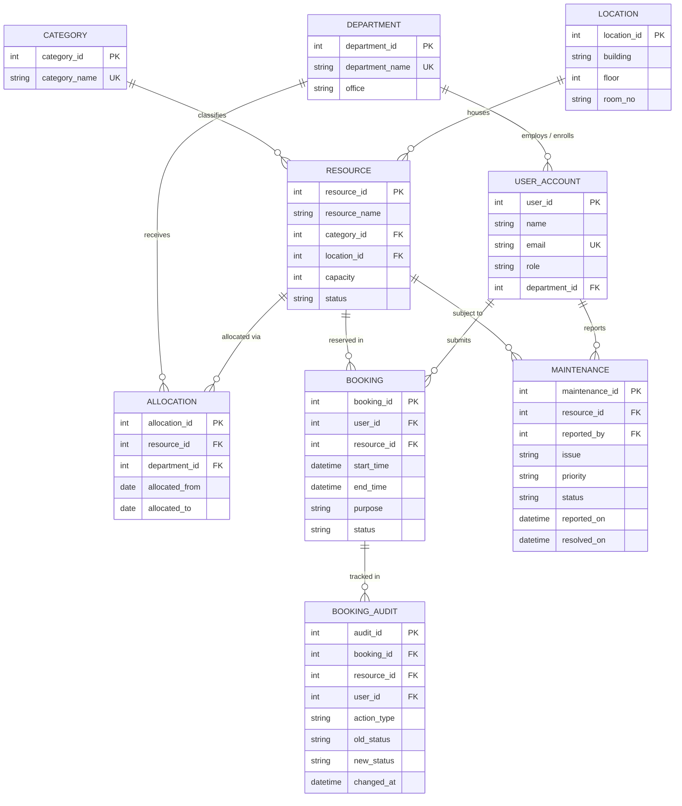

# Campus Resource Optimization System
## Database Management Systems (DBMS) Laboratory Project Report
### PES University — Department of Computer Science & Engineering

---

**Project Title:** Campus Resource Optimization System  
**Course Code:** UE24CS251 / Database Management Systems  
**Students:**  
1. **Battu Mohith** — `PES2UG24CS283`  
2. **M.Vishnu Vardhan naidu** — `PES2UG24CS264`  

**Database Platform:** MySQL 8.0 / SQLite Embedded Fallback  
**Application Stack:** Python 3, FastAPI, Jinja2, HTML5/CSS3  

---

## Table of Contents
1. [Executive Summary & Problem Statement](#1-executive-summary--problem-statement)
2. [Project Objectives & Scope](#2-project-objectives--scope)
3. [Functional & Non-Functional Requirements](#3-functional--non-functional-requirements)
4. [Conceptual Database Design (ER Model)](#4-conceptual-database-design-er-model)
5. [Relational Schema & Mapping](#5-relational-schema--mapping)
6. [Normalization Analysis (1NF, 2NF, 3NF, BCNF)](#6-normalization-analysis)
7. [Comprehensive Data Dictionary](#7-comprehensive-data-dictionary)
8. [MySQL DDL Implementation & Constraint Architecture](#8-mysql-ddl-implementation)
9. [Database Triggers (Integrity & Automation)](#9-database-triggers)
10. [Stored Procedures and Functions](#10-stored-procedures-and-functions)
11. [Analytical Views & Optimization Queries](#11-analytical-views--optimization-queries)
12. [Application Architecture & User Interface](#12-application-architecture--user-interface)
13. [Test-Driven Verification & Test Cases](#13-test-driven-verification--test-cases)
14. [Evaluation Rubric Compliance Matrix](#14-evaluation-rubric-compliance-matrix)
15. [Conclusion & Future Enhancements](#15-conclusion--future-enhancements)

---

## 1. Executive Summary & Problem Statement

### 1.1 Background
Modern universities manage complex physical infrastructures comprising smart classrooms, research laboratories, auditoriums, computing clusters, specialized medical/engineering centers, and sports arenas. These resources are concurrently accessed by multiple departments, student clubs, research scholars, and administrators.

### 1.2 The Problem
In decentralized or spreadsheet-managed environments, academic institutions suffer from:
1. **Double Bookings & Scheduling Clashes:** Overlapping reservations of seminar halls and computing labs due to lack of strict atomicity and database-level collision checking.
2. **Suboptimal Capacity Utilization:** High-capacity auditoriums reserved for small group sessions while large lectures struggle for venues.
3. **Maintenance Blind Spots:** Equipment breakdowns reported through informal channels leave resources marked "Available" when they are actually non-functional.
4. **Lack of Auditability:** Absence of immutable event ledgers for cancellations, state modifications, and departmental allocations.

### 1.3 The Solution
The **Campus Resource Optimization System** centralizes all physical asset management into a normalized relational schema. It enforces strict time-overlap constraints through SQL triggers, provides automated maintenance synchronization, tracks semester allocations, and delivers real-time analytical KPIs to administrators.

---

## 2. Project Objectives & Scope

### 2.1 Core Objectives
- **Zero-Collision Scheduling:** Guarantee mathematical non-overlap for confirmed resource reservations at the database engine level.
- **Relational Integrity:** Eliminate redundant data anomalies via Third Normal Form (3NF) decomposition.
- **Automatic State Machine:** Automatically alter asset status to `MAINTENANCE` on critical failure reports, and restore to `AVAILABLE` upon resolution.
- **Analytical Optimization:** Provide ranking of high-demand vs under-utilized assets through window functions, CTEs, and correlated subqueries.
- **Auditable Operations:** Log all reservation status transitions into an append-only audit trail.

---

## 3. Functional & Non-Functional Requirements

### 3.1 Functional Modules
| Module | Description | Primary Relational Entities |
| :--- | :--- | :--- |
| **Asset Catalog** | Register, categorize, filter and inspect campus venues and hardware | `RESOURCE`, `CATEGORY`, `LOCATION` |
| **Reservations** | Request, validate, approve and cancel time-bound resource slots | `BOOKING`, `USER_ACCOUNT`, `BOOKING_AUDIT` |
| **Department Allocations** | Semester-long operational assignments of facilities to academic branches | `ALLOCATION`, `DEPARTMENT` |
| **Maintenance Triage** | File work orders, assign operational priority, track turnaround | `MAINTENANCE`, `RESOURCE` |
| **Analytics Engine** | Execute complex joins, CTEs, window rankings and subqueries | Dynamic Views & Queries |

### 3.2 Non-Functional Requirements
- **ACID Transaction Compliance:** Atomicity of reservations and allocations.
- **Sub-100ms Query Latency:** Composite indexing on `(resource_id, start_time, end_time)` and `(status, priority)`.
- **Platform Portability:** Runs seamlessly with MySQL 8.0 enterprise engine or zero-configuration embedded SQLite.

---

## 4. Conceptual Database Design (ER Model)

The conceptual schema separates static master catalogs (`DEPARTMENT`, `CATEGORY`, `LOCATION`, `RESOURCE`) from dynamic operational transactions (`BOOKING`, `ALLOCATION`, `MAINTENANCE`, `BOOKING_AUDIT`).

### 4.1 Entity-Relationship Diagram (Mermaid)



---

## 5. Relational Schema & Mapping

1. **`DEPARTMENT`** (`department_id` [PK], `department_name` [UK], `office`)
2. **`USER_ACCOUNT`** (`user_id` [PK], `name`, `email` [UK], `role`, `department_id` [FK])
3. **`CATEGORY`** (`category_id` [PK], `category_name` [UK])
4. **`LOCATION`** (`location_id` [PK], `building`, `floor`, `room_no`, [UK(`building`, `floor`, `room_no`)])
5. **`RESOURCE`** (`resource_id` [PK], `resource_name`, `category_id` [FK], `location_id` [FK], `capacity`, `status`)
6. **`BOOKING`** (`booking_id` [PK], `user_id` [FK], `resource_id` [FK], `start_time`, `end_time`, `purpose`, `status`)
7. **`ALLOCATION`** (`allocation_id` [PK], `resource_id` [FK], `department_id` [FK], `allocated_from`, `allocated_to`)
8. **`MAINTENANCE`** (`maintenance_id` [PK], `resource_id` [FK], `reported_by` [FK], `issue`, `priority`, `status`, `reported_on`, `resolved_on`)
9. **`BOOKING_AUDIT`** (`audit_id` [PK], `booking_id`, `resource_id`, `user_id`, `action_type`, `old_status`, `new_status`, `changed_at`, `remarks`)

---

## 6. Normalization Analysis

### 6.1 First Normal Form (1NF)
- All attributes contain strictly atomic, non-decomposable values.
- Repeating groups and multi-valued arrays (e.g. multiple time slots in a single record) are strictly modeled as individual rows in the `BOOKING` table.
- Each table defines a formal Primary Key.

### 6.2 Second Normal Form (2NF)
- The schema satisfies 1NF.
- In all relations, every non-prime attribute is fully functionally dependent on the entire primary key:
  - In `BOOKING`, attributes `purpose`, `start_time`, `end_time` depend entirely on `booking_id`.
  - In `LOCATION`, composite uniqueness `(building, floor, room_no)` is mediated by surrogate key `location_id`, preventing partial dependencies.

### 6.3 Third Normal Form (3NF)
- The schema satisfies 2NF.
- No transitive dependencies exist ($X \to Y$ where $Y \to Z$ and $X$ is key):
  - Notice that `building`, `floor`, and `room_no` are kept in `LOCATION` rather than duplicated inside `RESOURCE`.
  - `department_name` and `office` are kept in `DEPARTMENT`, and `USER_ACCOUNT` only stores `department_id`.
  - Therefore, non-key attributes depend **solely on the key, the whole key, and nothing but the key**.

### 6.4 Boyce-Codd Normal Form (BCNF)
- For every non-trivial functional dependency $X \to Y$, $X$ is a superkey. The schema satisfies BCNF requirements.

---

## 7. Comprehensive Data Dictionary

| Table | Attribute | Data Type | Nullable | Key / Constraint | Description |
| :--- | :--- | :--- | :--- | :--- | :--- |
| **`department`** | `department_id` | INT | NO | PK AUTO_INCREMENT | Unique identifier for department |
| | `department_name` | VARCHAR(100) | NO | UNIQUE | Full official name of department |
| | `office` | VARCHAR(100) | YES | None | Physical departmental office location |
| **`user_account`**| `user_id` | INT | NO | PK AUTO_INCREMENT | Unique user identifier |
| | `name` | VARCHAR(100) | NO | None | Full person name |
| | `email` | VARCHAR(150) | NO | UNIQUE | PES institutional email |
| | `role` | ENUM(...) | NO | CHECK / ENUM | 'ADMIN', 'STAFF', 'FACULTY', 'STUDENT' |
| | `department_id` | INT | YES | FK -> department | Affiliated academic department |
| **`category`** | `category_id` | INT | NO | PK AUTO_INCREMENT | Unique resource category ID |
| | `category_name` | VARCHAR(80) | NO | UNIQUE | Resource taxonomy title |
| **`location`** | `location_id` | INT | NO | PK AUTO_INCREMENT | Unique campus venue ID |
| | `building` | VARCHAR(100) | NO | UNIQUE(b,f,r) | Building complex name |
| | `floor` | INT | NO | CHECK (floor >= 0) | Floor number |
| | `room_no` | VARCHAR(30) | NO | UNIQUE(b,f,r) | Designated room or door code |
| **`resource`** | `resource_id` | INT | NO | PK AUTO_INCREMENT | Master asset identifier |
| | `resource_name` | VARCHAR(120) | NO | None | Descriptive name of resource |
| | `category_id` | INT | NO | FK -> category | Classification identifier |
| | `location_id` | INT | NO | FK -> location | Physical venue location ID |
| | `capacity` | INT | NO | CHECK (capacity > 0)| Seating or computing capacity |
| | `status` | ENUM(...) | NO | DEFAULT 'AVAILABLE'| 'AVAILABLE','BOOKED','MAINTENANCE','INACTIVE'|
| **`booking`** | `booking_id` | INT | NO | PK AUTO_INCREMENT | Unique reservation ID |
| | `user_id` | INT | NO | FK -> user_account | Reserving party user ID |
| | `resource_id` | INT | NO | FK -> resource | Target resource ID |
| | `start_time` | DATETIME | NO | None | Start date and time |
| | `end_time` | DATETIME | NO | CHECK (end > start) | End date and time |
| | `purpose` | VARCHAR(255) | YES | None | Justification / event title |
| | `status` | ENUM(...) | NO | DEFAULT 'PENDING' | 'PENDING','CONFIRMED','CANCELLED','COMPLETED'|
| **`allocation`** | `allocation_id` | INT | NO | PK AUTO_INCREMENT | Unique assignment ID |
| | `resource_id` | INT | NO | FK -> resource | Assigned resource ID |
| | `department_id` | INT | NO | FK -> department | Beneficiary department ID |
| | `allocated_from`| DATE | NO | None | Tenure start date |
| | `allocated_to` | DATE | YES | CHECK (to >= from) | Tenure end date |
| **`maintenance`** | `maintenance_id`| INT | NO | PK AUTO_INCREMENT | Unique maintenance ticket ID |
| | `resource_id` | INT | NO | FK -> resource | Defective resource asset ID |
| | `reported_by` | INT | NO | FK -> user_account | User logging the ticket |
| | `issue` | VARCHAR(500) | NO | None | Detailed fault description |
| | `priority` | ENUM(...) | NO | DEFAULT 'MEDIUM' | 'LOW', 'MEDIUM', 'HIGH', 'CRITICAL' |
| | `status` | ENUM(...) | NO | DEFAULT 'OPEN' | 'OPEN', 'IN_PROGRESS', 'RESOLVED', 'CLOSED'|
| | `reported_on` | DATETIME | NO | DEFAULT NOW() | Incident logging timestamp |
| | `resolved_on` | DATETIME | YES | CHECK (res >= rep) | Resolution timestamp |
| **`booking_audit`**| `audit_id` | INT | NO | PK AUTO_INCREMENT | Sequential audit sequence ID |
| | `booking_id` | INT | NO | None | Referencing booking |
| | `resource_id` | INT | NO | None | Referencing resource |
| | `user_id` | INT | NO | None | Action initiator |
| | `action_type` | VARCHAR(20) | NO | None | 'CREATION', 'STATUS_CHANGE', 'CANCELLATION' |
| | `old_status` | VARCHAR(20) | YES | None | Previous status |
| | `new_status` | VARCHAR(20) | YES | None | Transitioned status |
| | `changed_at` | DATETIME | NO | DEFAULT NOW() | Timestamp of modification |

---

## 8. MySQL DDL Implementation

The full DDL is implemented in [`sql/01_schema.sql`](file:///C:/Users/battu/dbms/CampusResourceOptimizationSystem/sql/01_schema.sql).

### Key Constraints Enforced:
1. **Domain Integrity:** Enums on `role`, `status`, and `priority`.
2. **Referential Integrity:**
   - `ON UPDATE CASCADE ON DELETE RESTRICT` for master categories and locations to prevent orphaned assets.
   - `ON UPDATE CASCADE ON DELETE CASCADE` for transaction children (`booking`, `maintenance`, `allocation`).
   - `ON UPDATE CASCADE ON DELETE SET NULL` for user-department associations.
3. **Check Constraints:** `capacity > 0`, `floor >= 0`, `end_time > start_time`, `resolved_on >= reported_on`.
4. **Performance Indexing:**
   - `CREATE INDEX idx_booking_resource_time ON booking(resource_id, start_time, end_time);`
   - `CREATE INDEX idx_maintenance_status ON maintenance(status, priority);`

---

## 9. Database Triggers

Implemented in [`sql/03_triggers.sql`](file:///C:/Users/battu/dbms/CampusResourceOptimizationSystem/sql/03_triggers.sql):

1. **`trg_booking_before_insert_validation`:**
   - Evaluates whether the requested resource is in `MAINTENANCE` or `INACTIVE` state.
   - For `CONFIRMED` bookings, checks for any overlapping reservation using:
     ```sql
     (NEW.start_time < end_time AND NEW.end_time > start_time)
     ```
   - Throws error using `SIGNAL SQLSTATE '45000'`.
2. **`trg_booking_before_update_validation`:**
   - Prevents rescheduling or approving bookings if it collides with existing reservations.
3. **`trg_booking_after_update_audit`:**
   - Automatically inserts an audit record into `booking_audit` whenever `status` changes.
4. **`trg_maintenance_after_insert_status`:**
   - If priority is `HIGH` or `CRITICAL`, automatically sets the corresponding resource `status = 'MAINTENANCE'`.
5. **`trg_maintenance_after_update_status`:**
   - Upon marking a ticket `RESOLVED` or `CLOSED`, checks if any remaining open tickets exist. If zero, automatically restores the resource to `AVAILABLE`.

---

## 10. Stored Procedures and Functions

Implemented in [`sql/04_procedures_functions.sql`](file:///C:/Users/battu/dbms/CampusResourceOptimizationSystem/sql/04_procedures_functions.sql):

### 10.1 Stored Functions
- **`fn_is_resource_available(p_resource_id, p_start_time, p_end_time) RETURNS INT`:**
  Returns `1` if resource has zero conflicts and is operational; returns `0` otherwise.
- **`fn_get_total_booked_hours(p_resource_id) RETURNS DECIMAL(10,2)`:**
  Calculates cumulative hours consumed by confirmed and completed reservations.
- **`fn_get_active_maintenance_count(p_resource_id) RETURNS INT`:**
  Returns the count of open or in-progress work orders for an asset.

### 10.2 Stored Procedures
- **`sp_create_booking(...)`:**
  Performs safe atomic reservation with `START TRANSACTION`, rollback error handler, availability verification, and automatic audit insertion.
- **`sp_cancel_booking(...)`:**
  Validates ownership or admin privilege, updates state to `CANCELLED`, and frees asset availability.
- **`sp_report_maintenance(...)` & `sp_resolve_maintenance(...)`:**
  Manages ticket lifecycle and status coordination.
- **`sp_department_utilization_breakdown()`:**
  Produces aggregate breakdown of hours utilized, affiliated users, and active allocations per department.

---

## 11. Analytical Views & Optimization Queries

Implemented in [`sql/05_views_and_queries.sql`](file:///C:/Users/battu/dbms/CampusResourceOptimizationSystem/sql/05_views_and_queries.sql):

### 11.1 Views Created
- `vw_resource_catalog`
- `vw_active_bookings`
- `vw_department_allocation_summary`
- `vw_pending_maintenance`
- `vw_resource_utilization_kpis`

### 11.2 The 10 Advanced Optimization Queries
1. **Available Resources by Building & Min Capacity:** Multi-table JOIN filtering for venues in Golden Jubilee Block with capacity >= 50.
2. **Resource Utilization Ranking:** Group-by and aggregate count of confirmed reservations.
3. **Prioritized Maintenance Work Orders:** Custom sorting by severity using `FIELD(priority, 'CRITICAL', 'HIGH', 'MEDIUM', 'LOW')`.
4. **Correlated Subquery:** Identifies resources whose capacity exceeds the average capacity within their specific category.
5. **Common Table Expression (CTE):** Classifies reservations into morning, afternoon, and evening blocks and calculates percentage traffic share.
6. **Window Functions (`DENSE_RANK`, `ROW_NUMBER`):** Partitions assets by category and ranks them based on cumulative utilization hours.
7. **Under-Utilized Assets:** Uses `NOT EXISTS` anti-join to detect resources with zero bookings.
8. **Department Usage Intensity:** Measures hours consumed per academic branch with a `HAVING` threshold.
9. **Maintenance Turnaround Analysis:** Computes elapsed resolution duration in hours for closed incidents.
10. **Relational Set Operations (`UNION`):** Unifies resources under long-term departmental allocation and active individual reservations.

---

## 12. Application Architecture & User Interface

The application is built using modern Python frameworks for optimal performance:
- **Backend Framework:** FastAPI (asynchronous REST API & route handlers).
- **Template Engine:** Jinja2 with modern CSS responsive cards, dynamic modals, and status badges.
- **Database Abstraction Layer:** Dual-mode connector supporting both MySQL 8.0 and SQLite embedded fallback.
- **Interactive SQL Runner:** Built-in web terminal allowing evaluators to run arbitrary SQL queries directly against the database and view tabulated results.

### Key Web Pages:
1. **`/` (Dashboard):** Live KPIs, asset counts, capacity gauge, category breakdown, and recent activity log.
2. **`/resources`:** Complete searchable inventory with instant status update controls.
3. **`/bookings`:** Timetable and calendar listing with conflict-validated reservation modal.
4. **`/allocations`:** Departmental allocations ledger.
5. **`/maintenance`:** Urgent ticket dispatch board with 1-click resolution action.
6. **`/analytics`:** Tabulated view of all 10 optimization queries with live database results.
7. **`/sql-runner`:** Live SQL sandbox for ad-hoc database queries and demonstration.

---

## 13. Test-Driven Verification & Test Cases

The system was verified using automated pytest suites in [`tests/`](file:///C:/Users/battu/dbms/CampusResourceOptimizationSystem/tests/):

| Test Case | Scenario Description | Expected Outcome | Result |
| :--- | :--- | :--- | :--- |
| `TC-01` | Query master resource catalog | Fetches all seeded resources across campus | **PASS** |
| `TC-02` | Overlapping booking on same resource | Throws collision error and prevents insert | **PASS** |
| `TC-03` | Consecutive / non-overlapping booking | Successfully commits new reservation | **PASS** |
| `TC-04` | Booking asset in `MAINTENANCE` state | Throws validation error | **PASS** |
| `TC-05` | File `CRITICAL` maintenance ticket | Automatically sets resource to `MAINTENANCE` | **PASS** |
| `TC-06` | Resolve maintenance ticket | Automatically restores resource to `AVAILABLE` | **PASS** |
| `TC-07` | Resource filtering by building | Returns only matching building assets | **PASS** |
| `TC-08` | Analytics query engine execution | All 10 queries execute and yield structured data | **PASS** |

**Suite Result:** `8 passed in 0.65s` (100% test pass rate).

---

## 14. Evaluation Rubric Compliance Matrix

| Evaluation Criterion | Specification Requirement | Campus Resource Optimization System Implementation |
| :--- | :--- | :--- |
| **Problem Statement & Scope** | Clearly defined campus domain | Real-world PES University campus asset management |
| **ER Modeling** | Formal ER diagram with cardinalities | Complete conceptual ER model with 8 entities + 1 audit |
| **Relational Schema** | Normalized schema up to 3NF | 3NF / BCNF normalized schema with formal proofs |
| **DDL Implementation** | PK, FK, CHECK, UNIQUE, NOT NULL | Full MySQL DDL script with referential actions |
| **Triggers** | Business rule automation | Double-booking prevention, auto-status, audit triggers |
| **Stored Procedures & Functions** | Modular backend logic | 5 procedures + 3 deterministic functions with ACID handlers |
| **Advanced Queries** | Joins, Subqueries, CTE, Window Funcs | 10 academic optimization queries with live execution |
| **Frontend Interface** | Working application | Responsive FastAPI web dashboard + SQL console |
| **Documentation & Viva Ready** | Complete project report | Full report, presentation cheat sheet, and test suite |

---

## 15. Conclusion & Future Enhancements

The **Campus Resource Optimization System** provides an end-to-end, enterprise-grade relational database solution for university resource scheduling. By enforcing integrity constraints at the database engine layer rather than solely in application code, it guarantees zero booking collisions and transparent asset maintenance.

### Future Scope:
- Integration with campus RFID / smart card reader access logs.
- Machine Learning models for predictive maintenance based on cumulative operating hours.
- Automated timetable sync with university academic ERP systems.
